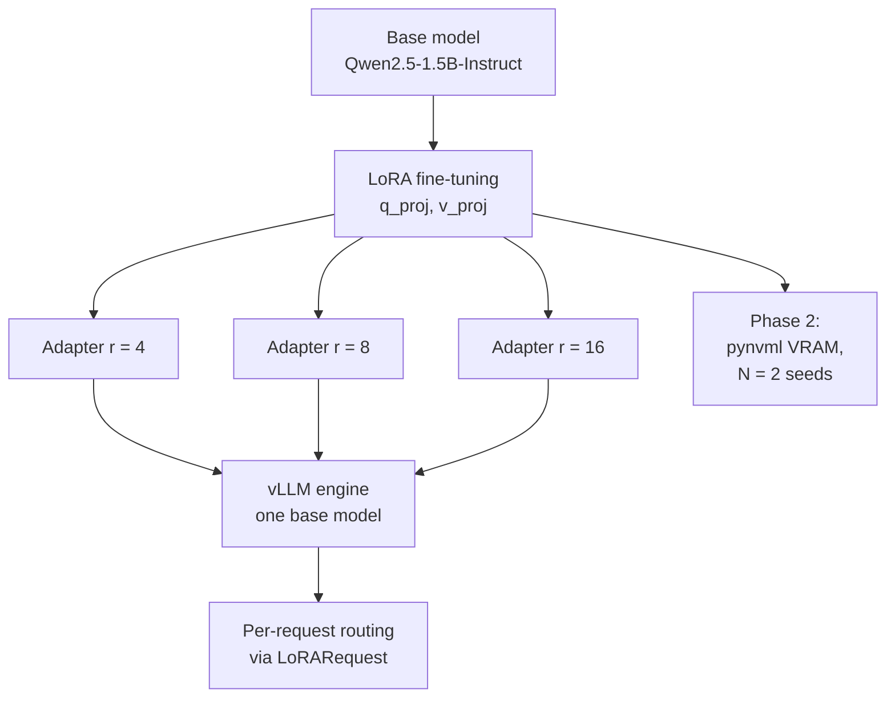
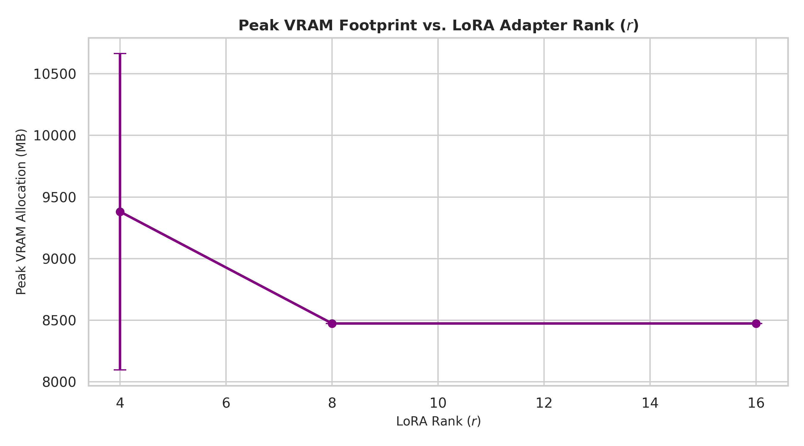
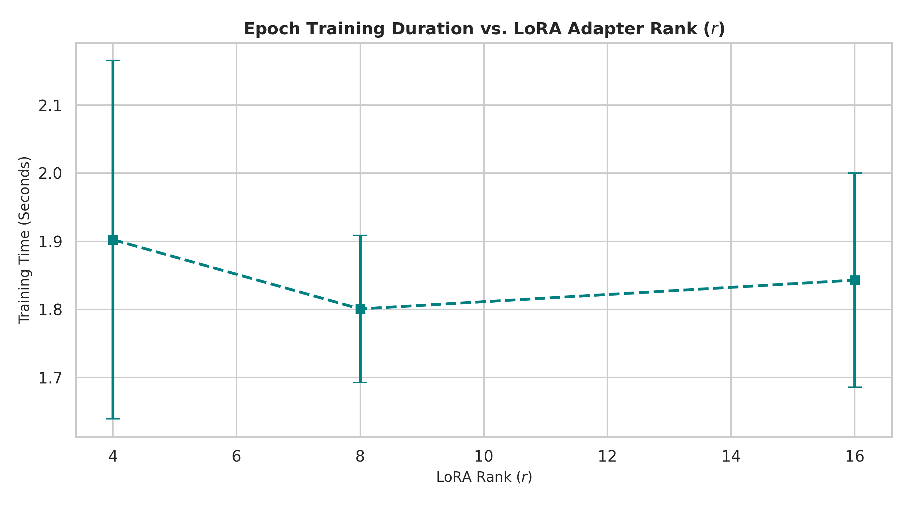

<div align="center">

# 🧬 LoRA Rank Ablation & Multi-Adapter Serving with vLLM

### Parameter-efficient fine-tuning, rank profiling and dynamic adapter routing on a small instruction-tuned LLM

[](https://www.python.org/)
[](https://pytorch.org/)
[](https://huggingface.co/docs/peft)
[](https://github.com/vllm-project/vllm)
[](https://huggingface.co/Qwen/Qwen2.5-1.5B-Instruct)
[](LICENSE)

[](https://colab.research.google.com/github/adriennie/vllm-lora-extension/blob/main/lora_peft_rank_ablation.ipynb)
[](https://nbviewer.org/github/adriennie/vllm-lora-extension/blob/main/lora_peft_rank_ablation.ipynb)

[**Highlights**](#-highlights) · [**Phase 1**](#-phase-1--rank-ablation--multi-adapter-serving) · [**Phase 2**](#-phase-2--rigorous-rank-profiling) · [**Reproduce**](#-reproducing-the-experiments) · [**Roadmap**](#-roadmap)

</div>

---

## 🚀 Highlights

| | |
| :-- | :-- |
| 🎯 **What it does** | Trains LoRA adapters at ranks **4, 8, 16** on `Qwen2.5-1.5B-Instruct`, then serves all of them from **one vLLM engine** with per-request adapter selection |
| 🧠 **Mechanism** | LoRA freezes the base model and learns low-rank weight updates. vLLM's multi-LoRA interface routes each request to the chosen adapter via `LoRARequest` |
| 📈 **Phase 1** | Rank ablation (trainable parameters, training loss, time, VRAM) plus a multi-adapter serving demo |
| 🧪 **Phase 2** | Re-run with `pynvml` device-level VRAM telemetry, multiple seeds (N = 2) and pinned run metadata |
| 🧾 **Provenance** | Raw metrics as CSV, one-prompt generations saved as JSON, runtime details recorded per run |
| 🖥️ **Hardware** | Kaggle GPU for Phase 1 training, NVIDIA Tesla T4 on Colab for Phase 2 and serving |

> **Honest scoping.** The training set is only **four unique examples repeated 25 times**, with one run per rank in Phase 1. These are exploratory results and do **not** show that any rank gives better quality. Serving demonstrates adapter routing, not a memory, throughput or latency benefit. Phase 2 exists to tighten the measurement side of that gap.

> 🔗 **Companion project:** the serving-side benchmarks (vLLM vs Hugging Face, PagedAttention block-size ablation) live in [`vllm-pagedattention-benchmark`](https://github.com/adriennie/vllm-pagedattention-benchmark).

---

## 📖 Background

**LoRA** (Low-Rank Adaptation) freezes a pretrained model's weights and learns low-rank updates for selected weight matrices. The **rank** sets the size of those updates: higher ranks add trainable parameters and can express higher-capacity changes. The method comes from Hu et al., [*LoRA: Low-Rank Adaptation of Large Language Models*](https://arxiv.org/abs/2106.09685) (2021).

**Multi-adapter serving** lets one engine hold a single copy of the base model and apply different adapters per request, instead of loading a full model per adapter. This repo is a small practical experiment, not a reproduction of either paper's evaluation.



---

## 🧱 Architecture

| Concern | Training notebooks | Serving notebook |
| :-- | :-- | :-- |
| Base model | `Qwen/Qwen2.5-1.5B-Instruct` | `Qwen/Qwen2.5-1.5B-Instruct` |
| Runtime | Hugging Face Transformers, TRL (`SFTTrainer`), PEFT | vLLM `LLM.generate()` |
| Adapter configuration | `q_proj`, `v_proj`; ranks 4, 8, 16 | LoRA enabled, `max_lora_rank=16` |
| Example data / request | Four hand-written conversion examples, repeated 25 times | One casual-to-formal prompt, run against base and each adapter |
| Artifacts | Adapter checkpoints and rank metrics | Saved example generations |

The serving notebook registers three adapters through `LoRARequest` handles and submits requests to a single engine. It also patches IPython output-stream `fileno()` behavior for Colab. vLLM is installed without a version pin and its active version is printed at runtime, so compatibility depends on the packages available when you run it.

**Stack:** Python · PyTorch · Hugging Face Transformers · TRL · PEFT · vLLM · `pynvml` · Google Colab · Kaggle

---

## 🔬 Phase 1 — Rank Ablation & Multi-Adapter Serving

### Task and setup

- **Task:** convert casual technical messages into formal academic sentences
- **Data:** four hand-written examples duplicated 25 times (100 rows, four unique)
- **Training:** 3 epochs, FP16, sequence length 256, per-device batch size 2, gradient accumulation 2, learning rate `2e-4`
- **LoRA config:** `q_proj` and `v_proj`, alpha 16, dropout 0.05, ranks 4 / 8 / 16
- **Recorded metrics:** trainable parameters and percentage, training time, peak allocated VRAM, final training loss

### Results

Source: [`results/lora_rank_ablation.csv`](results/lora_rank_ablation.csv)

| Rank | Trainable parameters | Trainable (%) | Training time (s) | Peak VRAM (GB) | Final training loss |
| --: | --: | --: | --: | --: | --: |
| 4 | 544,768 | 0.0353 | 55.50 | 6.55 | 2.4458 |
| 8 | 1,089,536 | 0.0705 | 47.83 | 4.76 | 2.4438 |
| 16 | 2,179,072 | 0.1410 | 48.55 | 4.77 | 2.4248 |

Trainable parameters scale linearly with rank (4× from r=4 to r=16), while the final training losses sit close together. Each rank was run once on a tiny repeated dataset, so loss, runtime and VRAM here are observations from those runs, not statistically reliable comparisons.

<div align="center">


*Trainable parameters (left) and final training loss (right) by LoRA rank.*

</div>

### Qualitative inference comparison

**Input:** *"PagedAttention stops GPU memory from being wasted when generating text."*

| Model | Output |
| :-- | :-- |
| **Base model** | The software PagedAttention effectively prevents GPU memory from being inefficiently utilized during the generation of text. |
| **Adapter (r = 4)** | PagedAttention effectively prevents GPU memory leaks during the generation of textual data by ensuring that the allocated memory is reused efficiently. |
| **Adapter (r = 8)** | PagedAttention effectively prevents GPU memory wastage by ensuring that only necessary model parameters are loaded into memory during text generation. |
| **Adapter (r = 16)** | PagedAttention effectively prevents GPU memory wastage during text generation by ensuring that only necessary data is retained in memory. |

Saved outputs: [`vllm_evaluation_results.json`](vllm_evaluation_results.json).

### Interpretation and known limits

- **Loss is not quality.** The notebook has no validation split, and copies of the same four examples cannot show generalization. Comparing ranks meaningfully needs multiple runs per rank and a held-out evaluation set.
- **No clean scaling curve.** Rank 4 shows the highest peak VRAM and longest duration in this single set of runs, which points to warmup and session effects rather than a real rank trend.
- **Faithfulness is unverified.** Some adapter outputs add details that were not in the input (see r = 8 and r = 16 above), so the one-prompt demo does not establish factuality.
- **Serving performance is unmeasured.** Multi-adapter routing is demonstrated, but there is no memory, throughput or latency comparison against a per-adapter model-loading baseline.

---

## 🧪 Phase 2 — Rigorous Rank Profiling

Phase 1's weakest points were single runs and allocator-based VRAM numbers. Phase 2 re-runs the rank ablation to address both.

| Upgrade | What it adds |
| :-- | :-- |
| 📡 **Device-level VRAM telemetry** | Background `pynvml` sampling thread records true peak VRAM rather than only PyTorch allocator counters |
| 🔁 **Seed repeatability** | **N = 2** seeds per rank, reporting mean and standard deviation for time and VRAM |
| 📌 **Pinned provenance** | Runtime and hardware versions recorded in [`lora_run_metadata.csv`](results_phase_2/lora_run_metadata.csv) |
| 📊 **Richer plots** | VRAM error-bar plot and a training-time chart |

### Results

Source: [`results_phase_2/lora_rank_ablation.csv`](results_phase_2/lora_rank_ablation.csv)

<!-- TODO: fill the cells from results_phase_2/lora_rank_ablation.csv.
     Trainable parameters should match Phase 1 if the LoRA config (q_proj, v_proj, alpha 16) is unchanged. -->

| LoRA rank | Trainable parameters | Mean train time (s) | Peak VRAM mean (MB) | Peak VRAM std (MB) |
| :-: | --: | --: | --: | --: |
| **4** | — | — | — | — |
| **8** | — | — | — | — |
| **16** | — | — | — | — |

<div align="center">



*`pynvml` peak VRAM by rank with standard-deviation bounds.*



*Epoch training duration by rank across seeds.*

</div>

---

## 📂 Repository Structure

```text
.
├── qwen_lora_rank_ablation.ipynb            # Phase 1: rank ablation training (Kaggle)
├── qwen_vllm_multi_adapter_serving.ipynb    # Phase 1: vLLM multi-adapter serving (Colab)
├── lora_peft_rank_ablation.ipynb            # Phase 2: pynvml profiling + seeded ablation (Colab)
├── vllm_evaluation_results.json             # Saved base and adapter generations
├── results/                                 # Phase 1 artifacts
│   ├── lora_adapter_r4/                     #   PEFT adapter, rank 4
│   ├── lora_adapter_r8/                     #   PEFT adapter, rank 8
│   ├── lora_adapter_r16/                    #   PEFT adapter, rank 16
│   ├── lora_rank_ablation.csv               #   Recorded rank metrics
│   └── lora_rank_ablation.png               #   Rank ablation plot
├── results_phase_2/                         # Phase 2 artifacts
│   ├── lora_rank_ablation.csv               #   Mean / std metrics per rank
│   ├── lora_run_metadata.csv                #   Runtime version provenance
│   ├── lora_rank_ablation.png               #   VRAM error-bar plot
│   └── lora_training_time_ablation.png      #   Training-time chart
├── LICENSE
└── README.md
```

---

## ▶️ Reproducing the Experiments

**Phase 1**

1. **Train.** Run `qwen_lora_rank_ablation.ipynb` on a Kaggle GPU. It trains ranks 4, 8 and 16 and writes adapter folders plus a metrics CSV.
2. **Copy adapters.** Put `lora_adapter_r4`, `lora_adapter_r8` and `lora_adapter_r16` in Google Drive. The tracked copies are under `results/`.
3. **Configure serving.** Open `qwen_vllm_multi_adapter_serving.ipynb` in Colab and set `ADAPTER_BASE_PATH` to the folder holding the adapters (default `/content/drive/MyDrive/results-2`).
4. **Generate.** Run the notebook to produce outputs from the base model and each adapter. It writes `vllm_evaluation_results.json` to the runtime's working directory.

**Phase 2**

1. Click **Open in Colab** above and select an **NVIDIA Tesla T4** (or better) runtime.
2. Run the cells in order: metadata capture → `pynvml` telemetry thread → seeded rank ablation → CSV and plot export.
3. Download the generated files into `results_phase_2/` and commit them.

> The notebooks install dependencies dynamically instead of using a pinned environment file. Model access may require a Hugging Face token. Supply it through the runtime's secret manager or environment variables and never commit it.

---

## 🗺️ Roadmap

- [x] Phase 1: LoRA rank ablation (4 / 8 / 16) and multi-adapter vLLM serving demo
- [x] Phase 2: `pynvml` device-level VRAM profiling and seeded repeat runs
- [ ] Evaluate on a larger held-out set with automatic metrics and human review for faithfulness
- [ ] Increase seeds beyond N = 2 for tighter variance estimates
- [ ] Benchmark multi-adapter serving against a per-adapter loading baseline (device-level memory, throughput, latency)
- [ ] Expand the ablation to more target modules and different alpha/rank ratios

---

## 📚 References

> Hu, E. J., Shen, Y., Wallis, P., Allen-Zhu, Z., Li, Y., Wang, S., Wang, L., & Chen, W. (2021). *LoRA: Low-Rank Adaptation of Large Language Models.* [arXiv:2106.09685](https://arxiv.org/abs/2106.09685)

> Kwon, W. et al. (2023). "Efficient Memory Management for Large Language Model Serving with PagedAttention." *SOSP 2023.* [arXiv:2309.06180](https://arxiv.org/abs/2309.06180)

> Chen, L. et al. (2023). "Punica: Multi-Tenant LoRA Serving." [arXiv:2310.18547](https://arxiv.org/abs/2310.18547)

## 📄 License

Released under the [MIT License](LICENSE).
