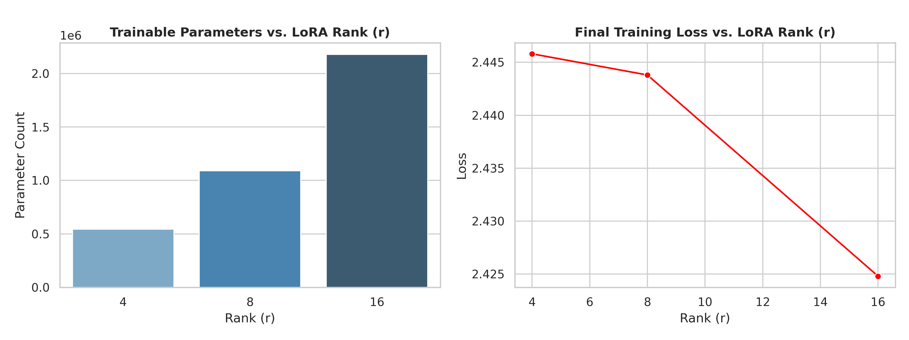

# LoRA Rank Ablation & Multi-Adapter Serving with vLLM

## Parameter-Efficient Fine-Tuning and Dynamic Adapter Routing

[](https://www.python.org/)
[](https://huggingface.co/Qwen/Qwen2.5-1.5B-Instruct)
[](LICENSE)
[](#reproducing-the-experiment)

### 🚀 At a Glance

* **Core Achievement:** Trained LoRA adapters at ranks 4, 8, and 16, then demonstrated selecting each adapter per request through one vLLM engine instance.
* **Mechanism:** LoRA learns low-rank weight updates while keeping the base model frozen. vLLM's multi-LoRA interface routes a request to the selected adapter.
* **Environment:** A Kaggle-oriented training notebook and a Colab-oriented vLLM serving notebook. The notebooks install packages at runtime; hardware and package versions are not pinned in this repository.

This project explores how LoRA rank affects trainable parameter count and recorded training loss for a small instruction-tuned model, then demonstrates how multiple adapters can be selected during inference without initializing a separate engine in the notebook for each adapter.

> **Key takeaway:** The recorded final training losses for ranks 4, 8, and 16 are 2.4458, 2.4438, and 2.4248, while trainable parameters rise from 544,768 to 2,179,072. The training data consists of only four unique examples repeated 25 times, with one run per rank; these results are exploratory and do not establish a general quality advantage for a particular rank. The serving notebook demonstrates adapter routing, but does not benchmark memory, throughput, or latency.

## Project overview

LoRA (Low-Rank Adaptation) freezes a pretrained model's weights and learns low-rank updates for selected weight matrices. The rank determines the size of these trainable updates: larger ranks add parameters and can represent higher-capacity updates.

This repository covers two steps:

1. **Fine-tuning:** an ablation over ranks 4, 8, and 16 using Hugging Face TRL's `SFTTrainer` and PEFT.
2. **Serving:** loading the resulting adapters in vLLM and selecting them with `LoRARequest` handles for generation.

The LoRA method is described in [*LoRA: Low-Rank Adaptation of Large Language Models*](https://arxiv.org/abs/2106.09685) by Hu et al. (2021). This repository is a small practical experiment, not a reproduction of the paper's evaluations.

## Architecture and implementation

| Concern | Training notebook | Serving notebook |
| --- | --- | --- |
| Base model | `Qwen/Qwen2.5-1.5B-Instruct` | `Qwen/Qwen2.5-1.5B-Instruct` |
| Runtime | Hugging Face Transformers, TRL, and PEFT | vLLM `LLM.generate()` |
| Adapter configuration | `q_proj`, `v_proj`; ranks 4, 8, 16 | LoRA enabled; `max_lora_rank=16` |
| Example data / request | Four hand-written conversion examples, repeated 25 times | One casual-to-formal prompt, run against base and adapters |
| Artifacts | Adapter checkpoints and rank metrics | Saved example generations |

The serving notebook registers three adapters using `LoRARequest` handles and submits requests through one engine instance. It also patches IPython output stream `fileno()` behavior for Colab. vLLM is installed without a version pin, and its active version is printed at runtime; compatibility depends on the packages available when the notebook is run.

**Technology:** Python, PyTorch, Hugging Face Transformers, TRL, PEFT, vLLM, Google Colab, and Kaggle.

## Rank ablation setup and workload

- **Base model:** `Qwen/Qwen2.5-1.5B-Instruct`.
- **Task:** Convert casual technical messages into formal academic sentences.
- **Training data:** Four hand-written examples duplicated 25 times (100 rows, four unique examples).
- **Training configuration:** Three epochs, FP16, sequence length 256, per-device batch size 2, gradient accumulation 2, and learning rate `2e-4`.
- **LoRA configuration:** `q_proj` and `v_proj`, alpha 16, dropout 0.05, and ranks 4, 8, and 16.
- **Recorded metrics:** Trainable parameter count and percentage, elapsed training time, peak allocated VRAM, and final training loss.

## Results

The following values are transcribed from [`results/lora_rank_ablation.csv`](results/lora_rank_ablation.csv).

| Rank | Trainable parameters | Trainable (%) | Training time (s) | Peak VRAM (GB) | Final training loss |
| ---: | ---: | ---: | ---: | ---: | ---: |
| 4 | 544,768 | 0.0353 | 55.50 | 6.55 | 2.4458 |
| 8 | 1,089,536 | 0.0705 | 47.83 | 4.76 | 2.4438 |
| 16 | 2,179,072 | 0.1410 | 48.55 | 4.77 | 2.4248 |

Trainable parameter count rises with rank, while the measured final training losses are close. Because each rank was run once on a tiny repeated dataset, the loss, runtime, and VRAM values are observations from those runs rather than statistically reliable comparisons.

### Interpretation and limits

The training loss is not a held-out quality measure. The notebook does not define a validation split, and repeated copies of the same four examples cannot establish generalization. Multiple runs per rank and evaluation on a separate dataset would be needed to compare ranks meaningfully.

The recorded training time and VRAM do not form a reliable scaling curve: rank 4 has the highest peak VRAM and longest duration in this single set of runs. Warmup and runtime-session conditions may affect these metrics.

The serving notebook uses one prompt to compare the base model and adapters. Some adapter outputs add details that were not in the input, so the examples do not establish factuality or faithfulness. The notebook also does not compare GPU memory, throughput, or latency with a per-adapter model-loading baseline. Multi-adapter routing is demonstrated, but its performance benefit is not measured here.

### Rank visualization



The plot is generated by the training notebook and summarizes the recorded parameter counts and final training losses.

## Qualitative inference comparison

**Input:** *“PagedAttention stops GPU memory from being wasted when generating text.”*

| Model | Output |
| --- | --- |
| Base model | The software PagedAttention effectively prevents GPU memory from being inefficiently utilized during the generation of text. |
| Adapter (r=4) | PagedAttention effectively prevents GPU memory leaks during the generation of textual data by ensuring that the allocated memory is reused efficiently. |
| Adapter (r=8) | PagedAttention effectively prevents GPU memory wastage by ensuring that only necessary model parameters are loaded into memory during text generation. |
| Adapter (r=16) | PagedAttention effectively prevents GPU memory wastage during text generation by ensuring that only necessary data is retained in memory. |

These are the saved outputs in [`vllm_evaluation_results.json`](vllm_evaluation_results.json), included as a one-prompt demonstration rather than a controlled evaluation.

## Repository structure

```text
.
├── qwen_lora_rank_ablation.ipynb             # Rank ablation training notebook
├── qwen_vllm_multi_adapter_serving.ipynb     # vLLM multi-adapter serving notebook
├── results/
│   ├── lora_adapter_r4/                      # PEFT adapter, rank 4
│   ├── lora_adapter_r8/                      # PEFT adapter, rank 8
│   ├── lora_adapter_r16/                     # PEFT adapter, rank 16
│   ├── lora_rank_ablation.csv                # Recorded rank metrics
│   └── lora_rank_ablation.png                # Rank ablation plot
├── vllm_evaluation_results.json              # Saved base and adapter generations
├── LICENSE
└── README.md
```

## Reproducing the experiment

1. **Train the adapters.** Open `qwen_lora_rank_ablation.ipynb` in a Kaggle GPU runtime and run the notebook. It trains ranks 4, 8, and 16 and writes adapter folders and a rank metrics CSV.
2. **Copy the adapter artifacts.** Place `lora_adapter_r4`, `lora_adapter_r8`, and `lora_adapter_r16` in Google Drive. The tracked adapter folders are under `results/`.
3. **Configure serving.** Open `qwen_vllm_multi_adapter_serving.ipynb` in Colab and set `ADAPTER_BASE_PATH` to the directory containing those folders. It defaults to `/content/drive/MyDrive/results-2`.
4. **Run inference.** Execute the notebook to generate with the base model and each adapter. It writes `vllm_evaluation_results.json` in the runtime's working directory.

The notebooks install dependencies dynamically rather than using a pinned environment file. Model access may require Hugging Face credentials; provide them through the notebook runtime's secret manager or environment variables, and do not commit tokens.

## Future iterations & roadmap

- [ ] Evaluate on a larger held-out set with automatic metrics and human review for faithfulness.
- [ ] Repeat each rank with multiple random seeds to estimate variation in loss, time, and VRAM.
- [ ] Pin notebook dependencies and record runtime versions and GPU details with each result.
- [ ] Benchmark multi-adapter serving against a defined baseline using device-level memory, throughput, and latency measurements.
- [ ] Expand the ablation to additional target modules and different alpha/rank ratios.

## Research references

> Hu, E. J., Shen, Y., Wallis, P., Allen-Zhu, Z., Li, Y., Wang, S., Wang, L., & Chen, W. (2021). *LoRA: Low-Rank Adaptation of Large Language Models*. arXiv preprint arXiv:2106.09685. [https://arxiv.org/abs/2106.09685](https://arxiv.org/abs/2106.09685)

> Kwon, W. et al. (2023). “Efficient Memory Management for Large Language Model Serving with PagedAttention.” *Proceedings of the 29th Symposium on Operating Systems Principles (SOSP 2023).* [arXiv:2309.06180](https://arxiv.org/abs/2309.06180)

> Chen, L. et al. (2023). “Punica: Multi-Tenant LoRA Serving.” [arXiv:2310.18547](https://arxiv.org/abs/2310.18547)

## License

Released under the [MIT License](LICENSE).
